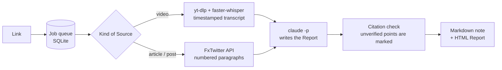

# Link Digest

Turns a saved video or article link into a detailed report where every point cites
its source.

Scrolling X turns up long videos, courses and articles worth knowing, but rarely
the time to watch or read them in full. Link Digest takes the link and gives back
the useful points and ideas, each one pointing to the timestamp or paragraph it
came from, so you can check any claim in the original instead of trusting a
summary.

It is early and run by one person. The base works end to end; most of what comes
next is listed under [Roadmap](#roadmap).

## How it works



- A video is fetched with yt-dlp and transcribed locally with faster-whisper, so it
  is cited by timestamp (`[12:34]`). Articles and text posts are cited by
  paragraph (`[¶3]`).
- The Report is written by Claude through the `claude` CLI, run with no tools, no
  settings and an empty working directory, because post content is untrusted and
  must not be able to act.
- Every citation is checked against the Source. A point whose quote isn't found
  where it cites is marked **(unverified)** rather than silently kept.
- The Telegram bot queues each Link in SQLite. A finished report is saved before
  it is sent, so a failed send retries only the send instead of making the report
  again.

The words used across the code (Link, Source, Segment, Report, Digest, Job) are
defined in [`CONTEXT.md`](CONTEXT.md).

## Requirements

- Python 3.12 and [uv](https://docs.astral.sh/uv/)
- [yt-dlp](https://github.com/yt-dlp/yt-dlp) and ffmpeg, for videos
- [Claude Code](https://docs.claude.com/en/docs/claude-code) installed and logged in
  as `claude`. Reports run on your own Claude account and count against its usage.

faster-whisper downloads its speech model on the first video.

## CLI

```sh
git clone https://github.com/Ali-Jabowr/link-digest
cd link-digest
uv sync
uv run link-digest <URL or local file> [--notes-dir DIR] [--html-dir DIR]
```

It takes X videos, X articles, X text posts, and videos from any other site yt-dlp
supports.

X articles and text posts are read through the third-party public FxTwitter API
(`api.fxtwitter.com`), which sees the ids of the posts you read. Only the post
itself is read: threads and links inside a post are not followed yet.

It writes a Markdown note and an HTML report, and prints their paths and the
citation counts. `./scripts/smoke.sh` runs the whole thing with the real tools on a
known clip.

## Telegram bot

The bot watches one Telegram group. Each new link in it is queued, digested, and
answered with a short summary and the HTML report. A link that was sent before is
not processed again, unless it failed: sending a failed link again retries it, and
reuses its report if one was already made.

1. Create a bot with BotFather (`/newbot`) and copy its token.
2. Turn off privacy mode with `/setprivacy` in BotFather, so the bot sees every
   message in the group.
3. Add the bot to the group.
4. Copy `deploy/env.example` to `~/.config/link-digest/env`, put the token after
   `TELEGRAM_BOT_TOKEN=`, and run `chmod 600 ~/.config/link-digest/env`.
5. Send any message in the group.
6. Run `link-digest-bot --print-chats` with the token in the environment, for
   example `set -a; . ~/.config/link-digest/env; set +a; uv run link-digest-bot
   --print-chats`. It prints `<chat id> <title>` for each chat the bot has seen.
7. Put the group's id after `LINK_DIGEST_CHAT_ID=` in the env file.
8. Copy `deploy/link-digest-bot.service` to `~/.config/systemd/user/`, then run
   `systemctl --user enable --now link-digest-bot`.

The unit expects the repo at `~/PROJECTS/link-digest` with its `.venv` built; edit
its paths if yours is elsewhere. The queue lives in
`~/.local/share/link-digest/queue.db`.

## Roadmap

Planned work is tracked as [GitHub issues](https://github.com/Ali-Jabowr/link-digest/issues).
Near term:

- A status message under each Link that shows its progress and errors, then an
  estimate of when its Report will be ready, built from recorded run times.
- Whole X threads, articles outside X, and links inside a post.
- Importing Links from a Telegram Desktop export, so none are lost while the bot
  is off.
- Pausing the queue while Claude is unavailable instead of failing jobs.

Later: more sources such as YouTube, Instagram and Reddit, and other ways to pull
information out of a video beyond its transcript.

## Contributing

Ideas, issues and pull requests are welcome, and so is advice on where to take it.
Open an issue first for anything bigger than a small fix, so we can agree on the
shape before you write code.

- `./.claude/verify.sh` is the gate: format, lint, strict types, tests and a
  dependency audit. It must pass, and CI runs it on every pull request.
- Tests come first: a new behaviour or a bug fix starts with a test that fails for
  the right reason, then the code that makes it pass.
- One test: `uv run pytest tests/test_x.py::test_name -q`.
- The pull request template asks how you proved the change works and how much AI
  helped. AI help is welcome; say so in the PR and in an `Assisted-by:` commit
  trailer.
- [`AGENTS.md`](AGENTS.md) holds the same rules for coding agents, and
  [`docs/adr/`](docs/adr/) records the decisions that are hard to reverse.

## License

[MIT](LICENSE)
